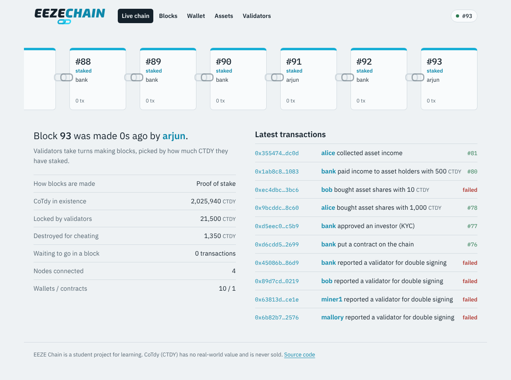
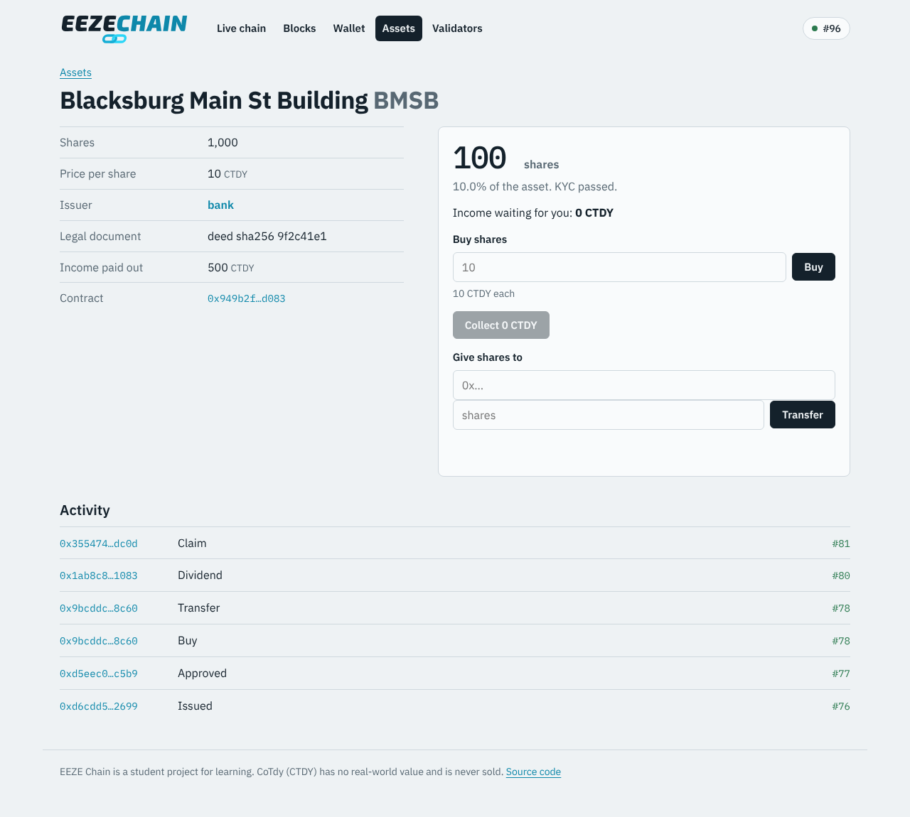
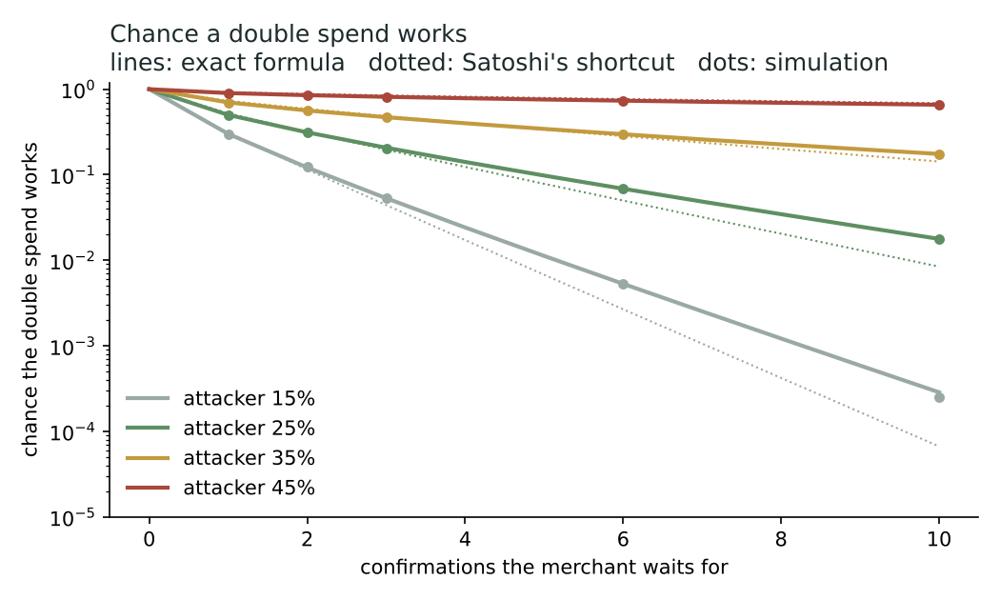
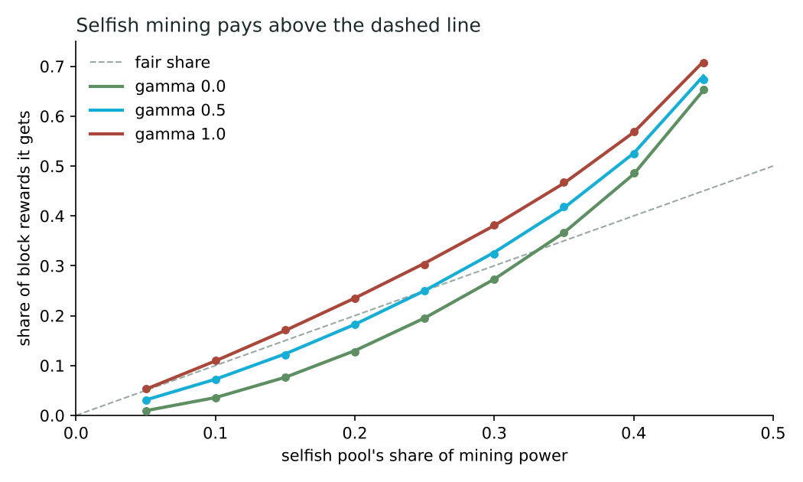

<p align="center">
  <picture>
    <source media="(prefers-color-scheme: dark)" srcset="web/public/brand/eeze-chain-logo-on-dark.svg">
    
  </picture>
</p>

# EEZE Chain

**My own blockchain, built from scratch. The network is EEZE Chain and its coin is CoTdy (CTDY).**

It has mining, then staking, smart contracts, and tokens for real-world things like a building split into shares. It also has a wallet and explorer you can open in your browser. I attacked it on purpose to see what breaks.

> This is a student project for learning. CoTdy has no real-world value. It's never sold, and nobody can buy it.

<p align="center"></p>

---

## What's a blockchain, in one minute

Picture a notebook that a whole classroom shares. Everyone has their own copy. When someone pays someone else, it gets written on the next page, and every copy gets the same line.

Two rules stop anyone from cheating:

1. **Every page has a fingerprint of the page before it.** Change one old line and its fingerprint changes. That breaks the fingerprint on the next page, and the next, all the way to today. Everyone can see you tampered with it.
2. **You can't just write a new page whenever you want.** You have to earn the right first. EEZE Chain starts with **mining**, where computers race to solve a puzzle, and then switches to **staking**, where people lock up coins and take turns.

A "block" is a page. The "chain" is the pages linked by their fingerprints.

---

## What EEZE Chain can do

- **Send CoTdy** from one wallet to another. Every payment is signed with a secret key, so nobody can spend your coins but you.
- **Mining (proof of work)** for the first 60 blocks. Computers guess numbers until a block's fingerprint starts with enough zeros. If blocks come too fast, the puzzle gets harder by itself.
- **Staking (proof of stake)** after that. People lock up CTDY to become validators. Each block, one is picked to make it, and more CTDY locked means a bigger chance, like holding more raffle tickets.
- **Catching cheaters.** If a validator signs two different blocks for the same turn, any node can prove it. The cheater loses half their locked coins, and whoever reported it gets a tenth of that.
- **Smart contracts.** Little programs that live on the chain and run the same way on every computer. Every step costs a tiny fee ("gas"), so a program stuck in a loop just runs out and stops.
- **Tokenized assets.** A contract that splits something real, like a building, into shares (more below).
- **A wallet and explorer** in your browser. Your key is made and kept on your computer. Only signed transactions leave it.

---

## Tokenizing a building

Say a bank owns a building worth 10,000 CTDY. It can split it into **1,000 shares at 10 CTDY each** and put them on EEZE Chain.

- **Only checked people can own shares.** The bank has to approve you first (that's "KYC", the ID checks real investments need). If you're not approved, the contract won't let shares reach you.
- **You buy shares straight from the contract.** You send exactly the right amount of CTDY, the shares come to you, and the CTDY goes to the bank, all in one step. Nobody can take your money and not deliver.
- **Rent gets shared out fairly.** When the building earns 500 CTDY of rent, everyone gets their slice by how many shares they hold. If you own 10%, you get 50. It costs the same whether there are 2 holders or 10,000, because the contract keeps a running total per share instead of paying everyone one by one.
- **The rules a real regulator would want.** The bank can freeze an account (say, on a court order), and can move shares out of a lost wallet. Every one of those actions is public on the chain.

This follows the same ideas as ERC-3643, a standard banks use for tokenized securities.

<p align="center"></p>

---

## I attacked it on purpose

Running `python sim/testnet.py` starts 6 nodes on one computer and puts the chain through everything. Each run is a bit different because mining is random. Here's one run.

**A real double spend.** Eve paid Bob 900 CTDY. Bob saw it confirmed 3 times and handed over the goods. But Eve had a secret computer with **4 times the mining power** of everyone else, building its own version of history where the 900 went to her other wallet. When she released it, it had more work behind it, so **every node switched to her version.** Bob's payment vanished from history.

```
[21:03:27 bob] REORG: dropped 31 block(s), switched to a heavier chain
Bob's payment now: unknown transaction
Bob's balance: 10,000.00 CTDY (the 900 is gone)   Eve's other wallet: 900.00 CTDY
```

That's why a chain is only as safe as its mining power is spread out.

**A cheating validator, caught.** Mallory signed two different blocks for the same turn and showed each half of the network a different one. Honest nodes noticed, sent in the proof, and she lost half her stake. She did it again and lost half of what was left. **2,025 CTDY was destroyed**, and she fell below the minimum and was kicked out.

```
[21:04:01 bob] CAUGHT 0x7121c1…2878 signing two blocks at #66 round 0. Reporting it.
Mallory's stake: 3,000 CTDY -> 750.00 CTDY
```

At the end, all the nodes agreed on the same chain, down to the last fingerprint.

---

## The maths of attacks

`python sim/attacks.py` checks the theory with simulations.

**How many confirmations is enough?** In the Bitcoin paper, Satoshi Nakamoto gave a formula for how likely a double spend is. It uses a shortcut. I simulated 200,000 attacks for each case and compared them with the exact formula (from Rosenfeld, 2014). The simulation matched the exact formula to within 0.2%. **Satoshi's shortcut understates the risk** at the waits people actually use:

| Attacker's share of mining power | Confirmations to wait for under 0.1% risk |
|---|---|
| 10% | 6 |
| 20% | 13 |
| 30% | 32 |
| 40% | 133 |

<p align="center"></p>

**Selfish mining.** A miner who hides blocks and releases them at the right moment can earn more than their fair share, even with less than half the power (Eyal and Sirer, 2014). My simulation lines up with their formula. With a third of the mining power, it starts to pay.

<p align="center"></p>

---

## How I built it

| Tool | What it does here |
|---|---|
| **Rust** | The core: blocks, signatures, mining, staking, slashing, the network, and the node's web API. Rust is what Solana and Polkadot are written in. It's fast and stops whole types of memory bugs. |
| **WebAssembly** | The smart-contract engine. Contracts compile to WebAssembly and run in a sandbox that counts every step for gas. |
| **AssemblyScript** | The language the building contract is written in. It looks like TypeScript and compiles to WebAssembly. |
| **TypeScript** | The wallet and explorer. It signs transactions in your browser with the exact same bytes the Rust node checks. |
| **Python** | Runs the 6-node test network and the attack simulations. |

The wallet signs in TypeScript and the node checks in Rust, so I tested that the two agree byte for byte. A transaction signed in the browser has the same fingerprint the node gives it.

---

## Run it yourself

You need [Rust](https://rustup.rs), [Node.js](https://nodejs.org) and Python 3 with `numpy` and `matplotlib`.

```
cargo build --release
cd contracts && npm install && npm run build && cd ..
cd web && npm install && npm run build && cd ..
```

Start a node that mines, then open **http://127.0.0.1:8001** for the explorer and wallet:

```
./target/release/eeze node --mine --key seed:arjun
```

Or run the full story with 6 nodes and leave it running to explore:

```
python sim/testnet.py --keep
```

Then open http://127.0.0.1:8102. In the wallet, pick a demo wallet like `alice`.

<details>
<summary>The command-line wallet</summary>

```
eeze keygen                                  make a wallet, saved to wallet.key
eeze devnet                                  the demo wallets
eeze balance --key seed:alice
eeze send --key seed:arjun --to 0x… --amount 12.5
eeze stake --key seed:bank --amount 5000
eeze deploy --key seed:bank --wasm contracts/build/rwa.wasm "str:Main St" str:MSB u64:1000 u64:1000000000 "str:deed hash"
eeze call --key seed:alice --contract 0x… --method buy --value 100 u64:10
eeze query --contract 0x… --method claimable addr:0x…
```

Point it at another node with `--rpc http://127.0.0.1:8102`.
</details>

<details>
<summary>Tests</summary>

```
cargo test --release
```

These tests cover sending, fees and replayed or tampered transactions, mining difficulty, forks and reorgs, blocks that arrive out of order, the switch from mining to staking, validator selection matching stake, slashing, unstaking delays, contracts running out of gas and undoing their changes on failure, Merkle proofs, and the whole tokenized-building story.
</details>

---

## For people who want the technical details

<details>
<summary>Blocks and transactions</summary>

- Keys are **Ed25519**. Hashes are **BLAKE3** with a label in front ("EEZE-TX", "EEZE-HDR"…), so a hash of one thing can never pass as another.
- An address is the first 20 bytes of the hash of the public key.
- Transactions use **accounts and nonces** (like Ethereum, not Bitcoin's coins-in-pieces model). The nonce stops replays, and the chain id inside the signature stops a transaction being reused on another network.
- Each block header holds a **Merkle root** of its transactions and of the whole state (every balance, stake and contract storage slot), so two nodes that agree on the root agree on everything. The core can make and check Merkle proofs.
- Fees use gas: 21,000 for a simple payment, plus every WebAssembly instruction and every storage read or write in a contract. Unused gas is refunded.
</details>

<details>
<summary>Consensus</summary>

- **Proof of work:** the header hash needs `bits` leading zero bits. Every 10 blocks, difficulty moves by log₂ of how far off the block time was (at most 4 bits per step).
- **Switch:** from block 60, if anyone has staked at least 1,000 CTDY. Until then, mining carries on.
- **Proof of stake:** for each height and "try" (round), a validator is picked from the hash of the previous block, weighted by stake. If the picked validator misses its slot, the next try opens after a timeout and someone else can step in.
- **Fork choice:** the most mining work, then the most staked blocks, then the fewest missed turns. Blocks older than 100 are final and can't be reorganized.
- **Slashing:** two validly signed headers from one validator for the same height and try. Half the stake (and half of anything still unbonding) is taken, a tenth goes to the reporter, and the rest is destroyed. Unstaking takes 20 blocks, so a cheater can't run before being caught.
</details>

<details>
<summary>Smart contracts</summary>

- The engine is **wasmi** with fuel metering. Floating point is switched off so every computer gets the exact same answer, and memory is capped at 16 MB.
- Contracts can only call 17 host functions (storage, caller, value, transfer, emit, revert…). Anything else is rejected before it gets on the chain.
- If a call fails, its storage changes and payments are thrown away. Only the fee is kept.
- Arguments use a small tagged format (number, bytes, address, text) shared by Rust, AssemblyScript and TypeScript.
- The building contract does its share maths in 128 bits, so it never overflows.
</details>

<details>
<summary>What this is not</summary>

It's a teaching chain, not something to put money on:

- Nodes talk in plain JSON over TCP, with no encryption and no protection against floods of junk messages.
- The browser wallet keeps its key in the browser's storage. Fine for demo coins, not for anything real.
- Staking picks validators from the previous block's hash. A real chain uses verifiable randomness, so a validator can't nudge who goes next.
- All of the testing was done on one computer.
</details>

The closest real-world designs: Bitcoin (proof of work and the double-spend maths), Ethereum (accounts, gas, slashing), Polkadot and NEAR (WebAssembly contracts), and ERC-3643 (permissioned security tokens).

---

## License

MIT. Use it, share it, build on it.

Made by Arjun Ramaswamy, Virginia Tech. Part of the EEZE family.
