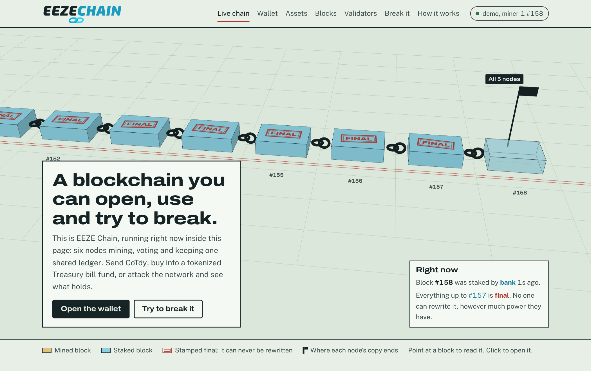
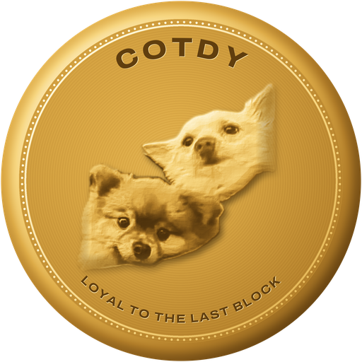
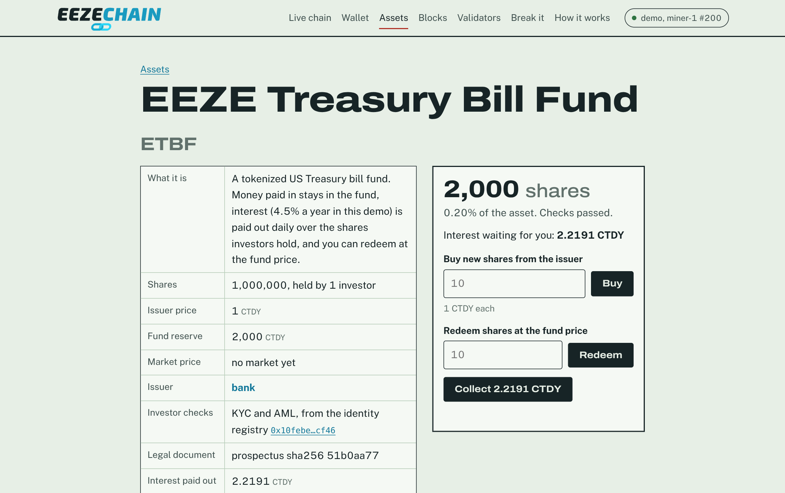
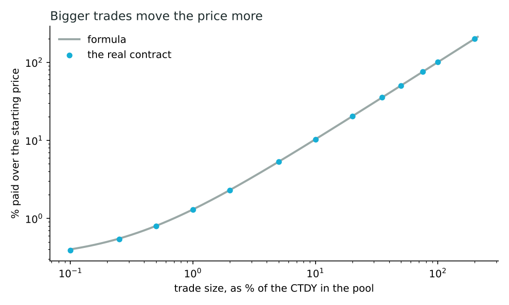
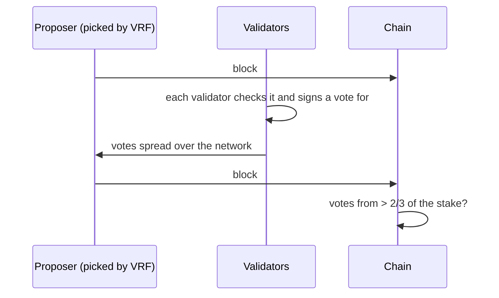
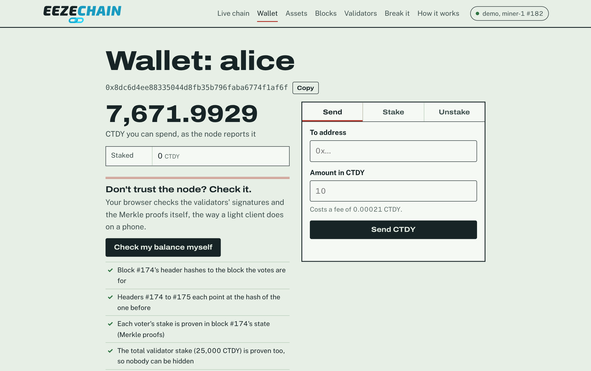
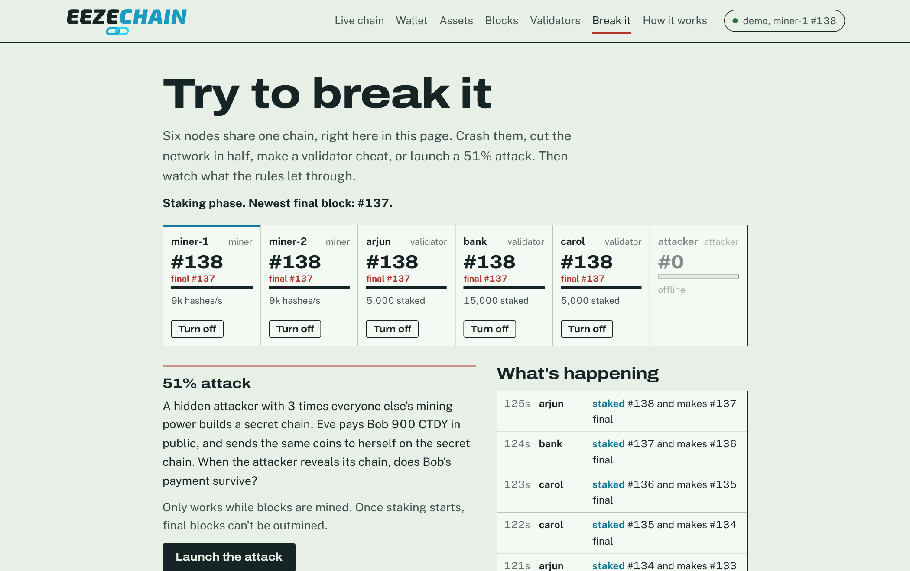
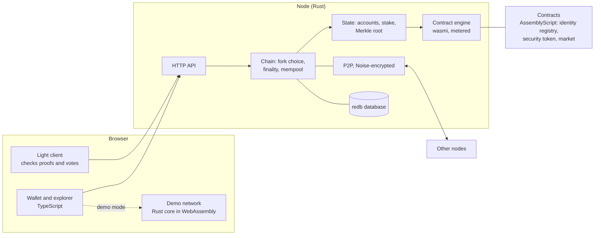

<p align="center"></p>

# EEZE Chain

[](https://github.com/arjunramaswamy71-lgtm/eeze-chain/actions/workflows/ci.yml)
[](https://arjunramaswamy71-lgtm.github.io/eeze-chain/)

**My own blockchain, built from scratch. The network is EEZE Chain and its coin is CoTdy (CTDY).**

It starts with mining, then switches to staking with fair validator picking (a VRF) and real finality. It runs smart contracts, and it can hold regulated assets: a tokenized Treasury bill fund and a building split into shares, with KYC rules like the ones banks use. Nodes talk over encrypted connections and keep the chain in a database. I attacked it on purpose, fuzzed it, and ran hours of simulated chaos against it.

### ▶ [Try it in your browser](https://arjunramaswamy71-lgtm.github.io/eeze-chain/)

No install. The page runs a real six-node EEZE Chain network inside your browser: the same Rust code the nodes use, compiled to WebAssembly. The chain is drawn live in 3D, and every block gets a red FINAL stamp once validators vote it final. Open **Try to break it** to cut the network in half, crash nodes, make a validator cheat, or launch a 51% attack, then watch the chain pull apart and come back together.

> This is a student project for learning. CoTdy has no real-world value. It's never sold, and nobody can buy it.

<p align="center"></p>

---

## CoTdy, the coin

<p align="center"></p>

**Loyal to the last block.** EEZE Chain's coin is named after my two dogs, Coco and Teddy: Co plus Tdy. Heads is the two of them, struck in gold from a real photo; tails is the chain. On the site it's a 3D coin you can flip, next to the story of the night Coco and Teddy stopped a 51% attack by eating the evidence.

A good dog sticks with you, whatever happens, and that's what a blockchain should do with your money: once a block is final, it stays final. CoTdy is never sold and has no price. It exists to show how a real chain works, and so two good dogs get to be on a coin.

---

## What's a blockchain, in one minute

Picture a notebook that a whole classroom shares. Everyone has their own copy. When someone pays someone else, it gets written on the next page, and every copy gets the same line.

Two rules stop anyone from cheating:

1. **Every page has a fingerprint of the page before it.** Change one old line and its fingerprint changes. That breaks the fingerprint on the next page, and the next, all the way to today. Everyone can see you tampered with it.
2. **You can't just write a new page whenever you want.** You have to earn the right first. EEZE Chain starts with **mining**, where computers race to solve a puzzle, and then switches to **staking**, where people lock up coins and take turns.

A "block" is a page. The "chain" is the pages linked by their fingerprints.

---

## What it does

| | |
|---|---|
| **Payments** | Send CTDY between wallets. Every payment is signed, so nobody can spend your coins but you. |
| **Mining, then staking** | Proof of work for the first 60 blocks, then proof of stake. |
| **Fair turns (VRF)** | Who makes the next block is drawn with a verifiable random function, so a validator can't rig the draw in its own favour. |
| **Finality** | Validators vote on blocks. Once votes from more than 2/3 of the stake are in, that block is final and no fork can ever undo it. |
| **Catching cheaters** | Signing two blocks for one turn, or voting for two blocks at one height, gets you slashed. You lose half your stake, and whoever reported you gets a tenth of that. |
| **Smart contracts** | Programs compiled to WebAssembly, run in a metered sandbox. Contracts can ask other contracts questions (read-only calls). |
| **Regulated assets** | An identity registry plus permissioned security tokens, following ERC-3643. The demo has a tokenized T-bill fund and a building. |
| **A market** | A built-in trading pool for asset shares (like Uniswap), with the same KYC rules. |
| **A wallet that checks the node** | The browser wallet checks your balance with Merkle proofs and validator signatures, so a lying node gets caught. |
| **Real networking** | Encrypted peer-to-peer connections (the Noise protocol, the same family WireGuard and Lightning use) and an on-disk database. |

---

## Tokenized assets, the way a bank would want them

The bank runs an **identity registry**. It records who has passed which checks (KYC, accredited investor, anti-money-laundering), which country they're in, and when each check expires. Only issuers the bank trusts can add those checks.

Assets are **security tokens** that ask the registry before every transfer. If the person receiving shares hasn't passed the required checks, the transfer just doesn't happen. That's the core idea of ERC-3643, the standard used for tokenized securities.

**The EEZE Treasury Bill Fund.** You buy shares at 1 CTDY each. Your money stays in the fund as a reserve, interest is paid out daily (4.5% a year in the demo), and you can redeem shares for CTDY from the reserve whenever you want. Interest is split only over shares investors hold, so the unsold stock still with the issuer doesn't soak any of it up.

**Main St Building.** 1,000 shares at 10 CTDY. Buyers pay the issuer directly, and rent is shared out by share. It costs the same whether there are 2 holders or 10,000, because the contract keeps a running total per share (in 128-bit maths, so it never overflows) instead of paying everyone one by one.

**The rules a regulator would ask for:**

- Pause all trading, freeze an account, or freeze just part of someone's shares (say, collateral for a loan).
- Forced transfers, for court orders. Only the issuer's agents can do them, and every one is public.
- Lost wallet recovery: shares and unpaid income move to your new wallet, but only if the registry says it's the same person.
- Limits on the number of holders and on how much one person can hold, and an allow-list of countries.
- Minting and burning, for when the fund grows or shrinks.

**The market.** Shares can also trade in a pool against CTDY, priced by the constant-product rule (x × y = k) with a 0.3% fee. Only KYC'd people can trade. `python sim/market.py` checks the pool against the formula: buying with 0.1% of the pool's CTDY costs 0.4% over the price (mostly the fee), 1% costs 1.3%, and 10% costs 10.3%. The contract matches the formula exactly. Doing this analysis caught a bug: buying whole shares used to keep the leftover CTDY. Now it charges exactly what the shares cost and sends back the change.

<p align="center"></p>
<p align="center"></p>

---

## How finality works



- **Turns.** For each height, the chain mixes the VRF outputs of past blocks into a random seed and draws a validator, weighted by stake. Anyone can check the draw with the proposer's VRF proof. Since the proof is fixed by the validator's key, trying different versions of a block can't change who goes next (there's a test for exactly this). If the picked validator misses its turn, the next try opens after a timeout.
- **Votes.** Each validator votes once per height, always for the tip of the best chain it knows, and its heights only go up.
- **Final means final.** A node will never switch to a chain that doesn't contain its last final block. Which chain is best: the one that's final furthest along, then the most mining work, then the most staking blocks, then the fewest missed turns.
- **Double votes are proof.** Two signed votes from one validator for two different blocks at the same height can be sent in as evidence by anyone. Slashing is half the stake. Unstaking takes 20 blocks, so a cheater can't run before being caught.

---

## The wallet checks the node

Most wallets believe whatever the server tells them. The EEZE wallet is a **light client**: press "Verify" and it checks everything itself, in your browser:

1. The final block's header really hashes to the block the votes are for, and the headers after it link up.
2. Every vote's signature is valid.
3. Each voter's stake is **proven** with a Merkle proof against the state root, and so is the total stake, so a node can't leave out validators who didn't vote.
4. The votes add up to more than 2/3 of the stake.
5. Your account is proven in that final block's state.
6. The chain links back to the last block your browser verified (a checkpoint).

The page shows a green tick or a red cross for each step.

<p align="center"></p>

---

## Trying to break it

**Attacks, on six real nodes.** `python sim/testnet.py` starts six node processes that talk over encrypted connections, then puts the chain through everything:

- **A real double spend (51% attack).** While the chain is still mined, Eve pays Bob 900 CTDY. Bob waits for 3 confirmations and hands over the goods. Meanwhile Eve's hidden computer, with 4 mining threads against the honest miner's one, builds its own history where the 900 went to her other wallet. When she releases it (42 blocks against the honest 34), every node switches. Bob's payment is erased. That's why proof of work is only as safe as the mining power is spread out, and why EEZE moves to staking with finality.
- **A validator signs two blocks for one turn.** Honest nodes spot it, send in the proof, and she's slashed twice: 3,000 CTDY of stake down to 750, with 2,025 CTDY destroyed.
- **Regulated assets end to end**: the fund, KYC refusals, interest, redemptions, and a market trade, all on the live network.
- At the end, every node agrees on the same chain.

<p align="center"></p>

**Chaos testing.** A test throws hours of simulated trouble at the in-browser network: the network splitting in half, nodes crashing and restarting, validators double-signing and double-voting. After every simulated second it checks the one rule that matters: **no two nodes ever disagree about a final block, and finality never goes backwards.**

| Run | Blocks | Network splits | Crashes | Cheats | Result |
|---|---|---|---|---|---|
| 6 simulated hours | 6,944 | 221 | 481 | 3 | Safety held. Every node ended on the same chain, final up to #6,943 |

The chaos test found a real bug. After a long split, the half with 60% of the stake kept finalizing on its own (once a cheater's stake was slashed, it had over 2/3). When the halves met again, the other nodes refused its blocks: an old mining-era rule rejected any block more than 100 behind their own tip, even though this fork was the better one. Safety never broke, but finality froze for 5 simulated hours. Now, once blocks are final, the last final block is the limit instead, and there's a test for exactly that case.

**Fuzzing.** Four fuzz targets (blocks, transactions, contract calls and the argument decoder) fed random and mutated input to the decoders and the checks, with AddressSanitizer on: about 23 million runs and no crashes.

**Property tests.** `proptest` checks rules over hundreds of random cases each: random runs of payments, stakes and unstakes never create or lose a coin, tampering with a signed transaction breaks its signature, a Merkle proof only works for its own leaf, decoding is the exact inverse of encoding, and the network and contract parsers never crash on junk.

**Benchmarks** (`cargo bench`, one core of a small cloud machine):

| | |
|---|---|
| Checking a block of 2,000 payments (signatures, state, Merkle root) | ~21,000 payments a second |
| Security-token transfers with the KYC check against the registry | ~840 a second |
| One signature check | 48 µs |
| VRF prove / verify | 114 µs / 119 µs |

Signature checks are most of the cost of a block, so batch verification and checking signatures in parallel would be the next speedups.

---

## The maths of attacks

`python sim/attacks.py` checks the theory with simulations.

**How many confirmations is enough?** In the Bitcoin paper, Satoshi Nakamoto gave a formula for how likely a double spend is. It uses a shortcut. I simulated 200,000 attacks for each case and compared them with the exact formula (from Rosenfeld, 2014). The simulation matched the exact formula to within 0.2%. **Satoshi's shortcut understates the risk** at the waits people actually use:

| Attacker's share of mining power | Confirmations to wait for under 0.1% risk |
|---|---|
| 10% | 6 |
| 20% | 13 |
| 30% | 32 |
| 40% | 133 |

<p align="center"></p>

**Selfish mining.** A miner who hides blocks and releases them at the right moment can earn more than their fair share, even with less than half the power (Eyal and Sirer, 2014). My simulation lines up with their formula. With a third of the mining power, it starts to pay.

<p align="center"></p>

---

## How it fits together



| Tool | What it does here |
|---|---|
| **Rust** | The core: blocks, signatures, mining, staking, VRF, finality, slashing, the contract engine, networking, storage and the node's API. Rust is what Solana and Polkadot are written in. It's fast and stops whole types of memory bugs. |
| **WebAssembly** | Two jobs: smart contracts compile to it and run in a sandbox that counts every step for gas, and the whole Rust core compiles to it so the demo network runs in a web page. |
| **AssemblyScript** | The language the contracts are written in. It looks like TypeScript and compiles to WebAssembly. |
| **TypeScript** | The wallet, explorer, light client and the 3D chain (three.js). It signs transactions in your browser with the exact same bytes the Rust node checks. |
| **Python** | Runs the six-node test network and the attack and market simulations. |

The browser demo and the real node answer requests with the same Rust function, so the website can't drift from the node: whatever the demo shows, a node would say the same.

---

## Design decisions

- **Mining first, then staking.** Mining is easy to start with, since nobody has to own coins yet. It also made the 51% attack something I could actually show, which is why the switch to staking matters.
- **A VRF instead of the previous block's hash.** My first version picked validators from the last block's hash. That lets a validator try many versions of its block until one gives it the next turn too ("grinding"). With a VRF the result is fixed by the validator's key, and everyone can check it.
- **Finality from votes, not from depth.** In version one, "final" meant 100 blocks deep, which is only a guess. Votes from more than 2/3 of the stake make finality something you can prove, which is also what lets a light client trust a balance.
- **Accounts, not coins-in-pieces.** Accounts and nonces (like Ethereum) make contracts and balances simpler to reason about than Bitcoin's model.
- **One contract per asset, plus a shared registry.** Identity is checked once by the bank and reused by every asset. That's the ERC-3643 idea, and it's how a real issuer would want it.
- **Income by running total.** Paying interest by looping over holders gets more expensive as holders grow. Keeping "income per share so far" makes every payout cost the same.
- **Same code in the browser and the node.** I compiled the Rust core to WebAssembly instead of writing a fake demo in JavaScript, so the live demo really is the chain.

**What I'd do differently next time:** design finality before the networking, not after. Adding votes to blocks late meant changing the header format, the light client, the database and the tests all at once. And I'd write the chaos test on day one. It found a bug no unit test did.

---

## What this is not

It's a teaching chain, not something to put money on:

- **Slashing only catches double votes at the same height.** Production finality designs like Ethereum's Casper FFG also slash "surround votes", which closes gaps where a validator votes on two forks at different heights. Safety held in all my tests, but it isn't proven against that.
- **The randomness has a small bias.** The last validator before a turn can choose to skip its block, which changes the seed. That's about one bit of influence, the same known limit as Ethereum's RANDAO.
- **If more than 1/3 of the stake goes offline, nothing gets finalized** until it comes back. Blocks keep coming, but there's no "inactivity leak" to slowly remove absent validators.
- **Connections are encrypted, but nodes don't check who they're talking to,** and there's no protection against floods of junk messages.
- **The browser wallet keeps its key in the browser's storage.** Fine for demo coins, not for anything real.
- **All testing ran on one computer.** The six testnet nodes are real processes, and the browser demo is a simulation of a network.

---

## Run it yourself

You need [Rust](https://rustup.rs), [Node.js](https://nodejs.org) and Python 3 with `numpy` and `matplotlib`.

```
cargo build --release
cd contracts && npm install && npm run build && cd ..
cd web && npm install && npm run build && cd ..
```

Start a node that mines, then open **http://127.0.0.1:8001** for the explorer and wallet:

```
./target/release/eeze node --mine --key seed:arjun
```

Or run the full story with six nodes, and leave it running to explore:

```
python sim/testnet.py --keep
```

Then open http://127.0.0.1:8102. In the wallet, pick a demo wallet like `alice`.

<details>
<summary>The command-line wallet</summary>

```
eeze keygen                                  make a wallet, saved to wallet.key
eeze devnet                                  the demo wallets
eeze balance --key seed:alice
eeze send --key seed:arjun --to 0x… --amount 12.5
eeze stake --key seed:bank --amount 5000     also registers your VRF key
eeze deploy --key seed:bank --wasm contracts/build/security.wasm "str:Main St" str:MSB str:property addr:0x<registry> u64:5 u64:1000000000 u64:1000 "str:deed hash"
eeze call --key seed:alice --contract 0x… --method buy --value 100 u64:10
eeze query --contract 0x… --method claimable addr:0x…
```

Point it at another node with `--rpc http://127.0.0.1:8102`.
</details>

<details>
<summary>Tests, fuzzing, chaos and benchmarks</summary>

```
cargo test --release                              core and node tests
cd wasm && cargo test --release                   the in-browser network and one simulated hour of chaos
CHAOS_HOURS=6 cargo test --release --test chaos   a longer chaos run
cargo bench -p eeze_core                          benchmarks
cd core/fuzz && cargo fuzz run block              fuzzing (also: transaction, contract, abi)
```

The tests cover payments and fees, replayed and tampered transactions, mining difficulty, forks and reorgs, out-of-order blocks, the switch to staking, VRF turns and grinding, finality and fake vote sets, final blocks never being undone, long forks that finalize more, double signing and double voting, light-client proofs, saving and restoring state, contracts running out of gas and undoing their changes, read-only contract calls, and the identity registry, security token, fund and market rules.
</details>

---

## For people who want the technical details

<details>
<summary>Blocks and transactions</summary>

- Keys are **Ed25519**. Hashes are **BLAKE3** with a label in front ("EEZE-TX", "EEZE-HDR"…), so a hash of one thing can never pass as another.
- An address is the first 20 bytes of the hash of the public key.
- Transactions use **accounts and nonces**. The nonce stops replays, and the chain id inside the signature stops a transaction being reused on another network.
- Each block header holds a **Merkle root** of its transactions and of the whole state (every balance, stake and contract storage slot, plus the total validator stake), so two nodes that agree on the root agree on everything, and a light client can check any one account.
- Fees use gas: 21,000 for a simple payment, plus every WebAssembly instruction and every storage read or write in a contract. Unused gas is refunded.
</details>

<details>
<summary>Consensus</summary>

- **Proof of work:** the header hash needs `bits` leading zero bits. Every 10 blocks, difficulty moves by log₂ of how far off the block time was (at most 4 bits per step).
- **Switch:** from block 60, if validators with at least 1,000 CTDY staked have registered VRF keys.
- **Proposer:** a stake-weighted draw from a seed that mixes in every block's VRF output, keyed by height and try. VRF is schnorrkel (Schnorr signatures over Ristretto, the one Polkadot uses), with the VRF key derived from the wallet key.
- **Votes and commits:** a vote signs "EEZE-VOTE", the chain id, the height and the block hash. A block can carry a commit (a set of votes for an earlier block). If the voters hold more than 2/3 of the stake, that block becomes final. The header commits to the vote set's root, so votes can't be swapped after the fact.
- **Fork choice:** (final height, mining work, staking blocks, on-time turns), compared in that order, never dropping the final block.
- **Slashing:** two signed headers for the same height and try, or two votes for different blocks at the same height. Half the stake (and half of anything unbonding) is taken, a tenth goes to the reporter, and the rest is destroyed.
</details>

<details>
<summary>Networking and storage</summary>

- Peers connect with the **Noise XX** handshake (X25519, ChaCha20-Poly1305, BLAKE2s), then exchange length-prefixed encrypted frames, chunked for big messages. Each node keeps its network key in its data folder.
- Blocks are saved in **redb**, an embedded database. Every 25 final blocks the node also saves a snapshot of the state, so restarting doesn't mean replaying the whole chain.
</details>

<details>
<summary>Smart contracts</summary>

- The engine is **wasmi** with fuel metering. Floating point is switched off so every computer gets the exact same answer, and memory is capped at 16 MB.
- Contracts can only use 19 host functions (storage, caller, value, transfer, emit, revert, read-only calls to other contracts…). Anything else is rejected before it gets on the chain.
- A read-only call can't write storage, send coins or emit events. If it tries, the call fails. Calls can go at most 4 deep.
- If a call fails, its storage changes and payments are thrown away. Only the fee is kept.
- Arguments use a small tagged format (number, bytes, address, text) shared by Rust, AssemblyScript and TypeScript.
</details>

The closest real-world designs: Bitcoin (proof of work and the double-spend maths), Ethereum (accounts, gas, slashing, finality votes), Polkadot (WebAssembly contracts and the VRF), Tendermint (2/3 voting), Uniswap v2 (the market pool) and ERC-3643 (permissioned security tokens).

---

## License

MIT. Use it, share it, build on it.

Made by Arjun Ramaswamy, Virginia Tech. Part of the EEZE family.
